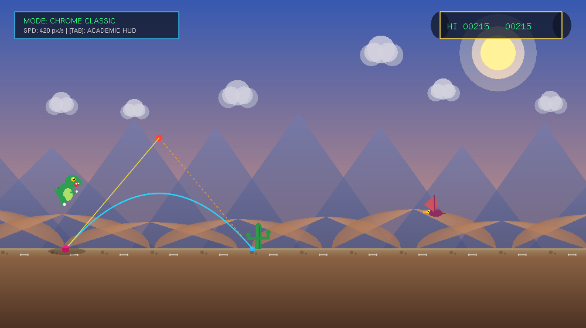
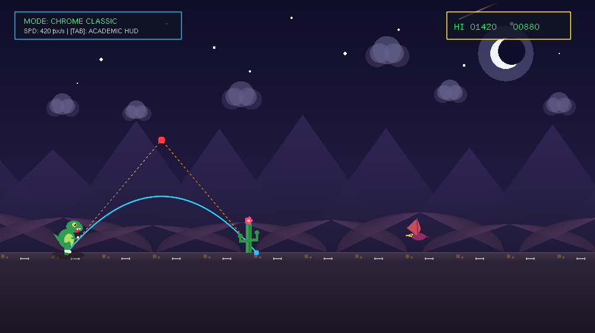
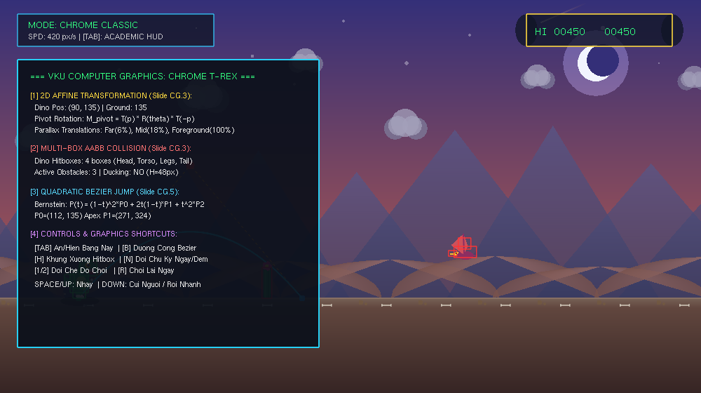
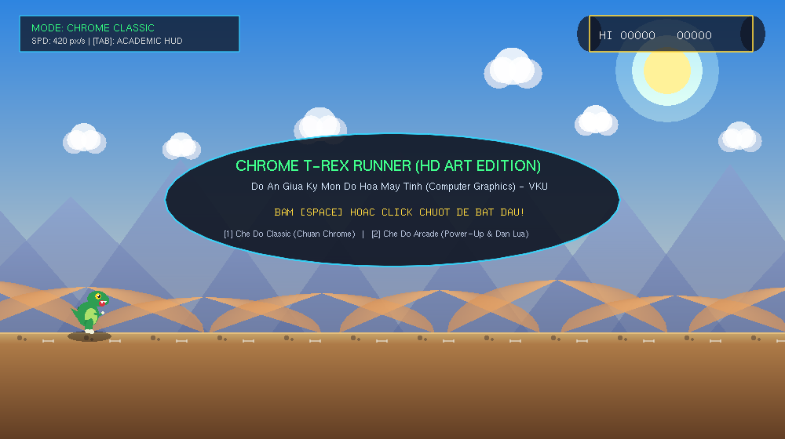

# BÁO CÁO BÀI TẬP GIỮA KỲ: MÔN ĐỒ HỌA MÁY TÍNH (COMPUTER GRAPHICS)
**TRƯỜNG ĐẠI HỌC CÔNG NGHỆ THÔNG TIN & TRUYỀN THÔNG VIỆT - HÀN (VKU)**  
**KHOA KỸ THUẬT MÁY TÍNH & ĐIỆN TỬ**  
**ĐỀ TÀI: GAME KHỦNG LONG T-REX 2D (CHROME DINOSAUR RUNNER: HIGH-DEFINITION ART EDITION)**

🔗 **GitHub Repository:** [https://github.com/IT31072006/DoHoaMayTinh](https://github.com/IT31072006/DoHoaMayTinh)

---

## ẢNH CHỤP MÀN HÌNH TRẢI NGHIỆM ĐỒ HỌA THỰC TẾ
*(Chụp trực tiếp từ chương trình OpenGL / FreeGLUT C++ đang chạy)*

### 1. Ban Ngày Sa Mạc Tiền Sử (Daytime Desert Landscape)


### 2. Ban Đêm Huyền Ảo Ngân Hà (Night Sky & Crescent Moon)


### 3. Bảng Phân Tích Học Thuật Đồ Họa Máy Tính & Khung Xương Hitbox (Phím `TAB`)


### 4. Màn Hình Bắt Đầu Trò Chơi (Start Screen)


---

## 1. GIỚI THIỆU ĐỀ TÀI & NÂNG CẤP ĐỒ HỌA

Khi mất kết nối Internet trên Google Chrome, người dùng đều quen thuộc với trò chơi kinh điển **Chrome T-Rex Dinosaur Runner**. 

Dự án này đã được phát triển và nâng cấp đồ họa toàn diện theo chuẩn **Đồ Họa Máy Tính Nghệ Thuật Nâng Cao (HD Art Edition)**:
* **Nhân vật Khủng Long T-Rex sống động:** Tạo hình giải phẫu cơ bắp chi tiết với thân xanh ngọc bích, bụng màu vàng chanh sáng counter-shading, gai sống lưng sừng nhọn, mắt hổ phách có con ngươi đen và điểm sáng specular, khớp chân xoay luân phiên quanh khớp háng bằng ma trận Affine, cùng vệt bóng elip đổ mềm trên mặt đất.
* **Môi trường Sa mạc Tiền sử Đa tầng Thị sai (Parallax 3 Layers):** 
  - *Tầng 1 (Xa):* Dãy núi tiền sử cao vút phủ sương mờ khí quyển.
  - *Tầng 2 (Trung):* Đụn cát mềm mại màu đất nung.
  - *Tầng 3 (Gần):* Địa tầng mặt đất sa mạc nhiều lớp cát, sỏi và hóa thạch xương khủng long.
* **Bầu trời & Thiên thể Gradient:**
  - Mặt trời vàng ấm với nhiều lớp hào quang phát sáng (Corona).
  - Mặt trăng khuyết lưỡi liềm (Crescent Moon) và bầu trời sao lấp lánh ban đêm kèm vệt sao băng lướt ngang.
* **Chướng ngại vật phong phú:**
  - Cây xương rồng Saguaro xanh lục bảo có rãnh thân đổ bóng nổi và hoa sa mạc nở rộ rực rỡ màu hồng cánh sen.
  - Thằn lằn bay (Pterodactyl) với màng cánh đỏ mận, mào đầu và mỏ nhọn đập cánh nhịp nhàng quanh khớp vai.

---

## 2. BẢNG TỔNG HỢP CÁC THUẬT TOÁN ĐỒ HỌA ÁP DỤNG (THEO SLIDE BÀI GIẢNG VKU)

| STT | Thuật toán Đồ họa | Bài giảng / Lab VKU | Vị trí áp dụng cụ thể trong Game |
|:---:|:---|:---|:---|
| **1** | **Phép biến đổi Affine 2D trên Ma trận thuần nhất 3x3** | **Slide CG.3 & Lab 3** | Cài đặt cấu trúc `Matrix3x3` tự xây dựng: Tịnh tiến thị sai đa tầng ($T$), Phép quay quanh tâm khớp ($R_{pivot}$ cho 2 chân chạy luân phiên quanh khớp háng và cánh chim vỗ quanh khớp vai), Co giãn ($S$ khi cúi người) và Quay ngã khi Game Over. |
| **2** | **Phát hiện va chạm Hộp bao AABB đa tầng (Multi-Box AABB Collision)** | **Slide CG.3 & Lab 2** | Kiểm tra va chạm giữa Khủng long và Xương rồng / Chim bay. Khủng long có các hộp bao riêng biệt cho Đầu, Thân, Chân, Đuôi. Khi cúi người (`↓`), hộp bao tự co hạ thấp chiều cao để né chim bay tầm trung. |
| **3** | **Đường cong Bézier bậc 2 (Quadratic Bézier Curve)** | **Slide CG.5 & Lab 5.3** | Đa thức Bernstein bậc 2 và thuật toán De Casteljau dùng để vẽ Quỹ đạo nhảy dự báo (Trajectory Preview) động với các điểm kiểm soát $P_0, P_1, P_2$. |
| **4** | **Thuật toán Midpoint vẽ đường tròn** | **Slide CG.3 & Lab 1.2** | Vẽ Mắt tròn khủng long, Trăng lưỡi liềm (Crescent Moon) ban đêm, hào quang mặt trời, các đốm mây và vụn nổ. |
| **5** | **Thuật toán Bresenham vẽ đoạn thẳng** | **Slide CG.3 & Lab 1.1** | Vẽ các vết rạn nứt trên mặt đất sa mạc, gai xương rồng, đa giác kiểm soát nét đứt của đường cong Bézier. |
| **6** | **Hệ thống Hạt 2D (Particle System)** | **Slide CG.6 (Kỹ thuật nâng cao)** | Tung bụi cát xoáy sau gót chân khủng long khi chạy và tiếp đất; hiệu ứng nổ tung các tia lửa và mảnh vụn khi va chạm. |
| **7** | **Đổ bóng hình học mềm (Soft Geometric Drop Shadow)** | **Slide CG.3 & CG.6** | Bóng elip mềm dưới chân khủng long co giãn kích thước và mờ dần độ trong suốt theo độ cao cú nhảy. |
| **8** | **Chu kỳ Ngày / Hoàng Hôn / Đêm Gradient** | **Slide CG.2 & CG.3** | Nội suy dải màu bầu trời mượt mà theo tiến trình điểm số, chuyển đổi giữa bình minh, hoàng hôn rực rỡ và đêm ngân hà. |

---

## 3. CƠ SỞ TOÁN HỌC & CÔNG THỨC CHI TIẾT

### 3.1. Phép biến đổi hình học Affine 2D trên Ma trận thuần nhất 3x3
Theo giáo trình Đồ họa máy tính VKU (Tọa độ thuần nhất dạng vector dòng $[x, y, 1]$):
$$[x', y', 1] = [x, y, 1] \cdot M$$

#### Phép quay quanh tâm khớp bất kỳ $P_{pivot}(x_p, y_p)$ (Khớp háng chân khủng long, Khớp vai cánh chim):
$$M_{pivot} = T(-x_p, -y_p) \cdot R(\theta) \cdot T(x_p, y_p)$$
$$\begin{bmatrix} x' \\ y' \\ 1 \end{bmatrix}^T = \begin{bmatrix} x \\ y \\ 1 \end{bmatrix}^T \cdot \begin{bmatrix}
\cos\theta & \sin\theta & 0 \\
-\sin\theta & \cos\theta & 0 \\
x_p(1 - \cos\theta) + y_p\sin\theta & y_p(1 - \cos\theta) - x_p\sin\theta & 1
\end{bmatrix}$$

---

### 3.2. Thuật toán Phát hiện va chạm Hộp bao AABB (Axis-Aligned Bounding Box)
Một hộp bao AABB được định nghĩa bởi góc dưới-trái $(x, y)$ cùng kích thước $(w, h)$:
$$\text{Intersects}(A, B) \iff (x_A < x_B + w_B) \land (x_A + w_A > x_B) \land (y_A < y_B + h_B) \land (y_A + h_A > y_B)$$

---

### 3.3. Thuật toán Đường cong Bézier bậc 2 (Quadratic Bézier Curve)
Định nghĩa bởi 3 điểm kiểm soát $P_0$ (giậm nhảy), $P_1$ (đỉnh apex), $P_2$ (tiếp đất):
$$P(t) = (1 - t)^2 P_0 + 2t(1 - t) P_1 + t^2 P_2, \quad t \in [0, 1]$$

Thuật toán De Casteljau chia đoạn nội suy:
$$\begin{cases}
Q_0(t) = (1 - t)P_0 + t P_1 \\
Q_1(t) = (1 - t)P_1 + t P_2 \\
P(t) = (1 - t)Q_0(t) + t Q_1(t)
\end{cases}$$

---

## 4. HƯỚNG DẪN CÀI ĐẶT & KHỞI CHẠY TRÒ CHƠI

Mã nguồn được lập trình bằng C++ chuẩn và thư viện đồ họa **FreeGLUT / OpenGL**, hoàn toàn độc lập, không phụ thuộc engine ngoài.

### 4.1. Dành cho Ubuntu / Linux
1. Cài đặt thư viện đồ họa (nếu chưa có):
   ```bash
   sudo apt update && sudo apt install -y freeglut3-dev build-essential
   ```
2. Khởi chạy game ngay lập tức:
   ```bash
   cd "/home/quan/Nam 3/Do hoa may tinh/BT_Gki"
   ./run.sh
   # hoặc:
   make run
   ```

### 4.2. Dành cho Windows (Dev-C++ / Code::Blocks / Visual Studio)
Theo cấu hình phòng máy VKU:
1. Mở Dev-C++ -> Tạo Project mới (Console Application, C++).
2. Thêm file `main.cpp` vào Project.
3. Vào **Project Options** (`Ctrl + H`) -> Thẻ **Parameters** -> Mục **Linker**, thêm:
   ```text
   -lglut32 -lglu32 -lopengl32
   ```
4. Nhấn `F11` (Compile & Run).

---

## 5. BẢNG PHÍM TẮT ĐIỀU KHIỂN

| Thao tác | Phím bấm / Chuột | Chức năng |
|:---|:---:|:---|
| **Bắt đầu / Nhảy** | `SPACE` / `W` / `↑` / **Click Chuột** | Nhảy qua chướng ngại vật (giữ để nhảy cao hơn). |
| **Cúi người (Duck)** | Giữ `S` hoặc `↓` | Khủng long cúi rạp người né chim bay tầm trung. |
| **Rơi nhanh (Fast-Fall)** | Nhấn `↓` khi đang trên không | Lao nhanh xuống đất lập tức. |
| **Bật/Tắt Bảng Học Thuật** | Phím `TAB` | Xem công thức Affine, Multi-Box AABB, Bézier, FPS. |
| **Khung xương Hitbox** | Phím `H` | Bật/Tắt hiển thị viền hộp bao va chạm AABB xanh/đỏ. |
| **Quỹ đạo Bézier** | Phím `B` | Bật/Tắt đường cong Bézier dự báo cú nhảy. |
| **Đổi Ngày / Đêm** | Phím `N` | Chuyển đổi thủ công giữa ban ngày và ban đêm. |
| **Chọn Chế độ Chơi** | Phím `1` hoặc `2` | `1`: Classic Chrome, `2`: Arcade Power-Up. |
| **Chơi lại (Restart)** | Phím `R` | Đặt lại vòng chơi mới. |
| **Chụp ảnh màn hình** | Phím `F12` | Lưu ảnh màn hình ra file BMP. |
| **Thoát game** | `ESC` hoặc `Q` | Đóng trò chơi. |
